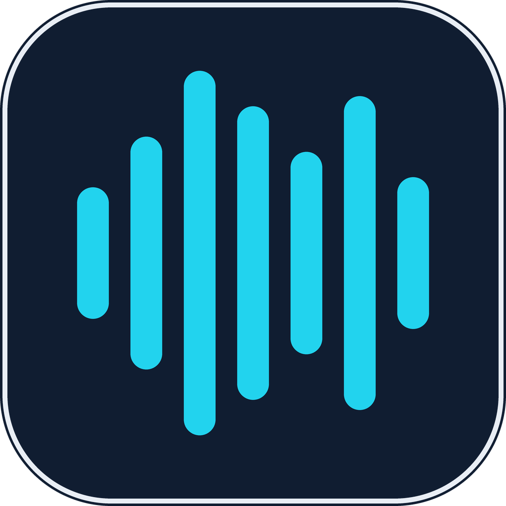
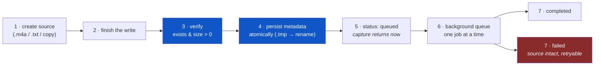

<div align="center">



# Augustyniak Capture

**Offline-first capture queue for voice, text, images and video.**
Your thought lands on disk *before* anything clever is attempted with it.



[](https://flutter.dev)
[](https://dart.dev)
[](docs/platform-setup.md)
[](#-the-one-guarantee)
[](LICENSE)
[](https://laugustyniak.github.io/augustyniak-capture/)

[Quick start](#-quick-start) ·
[For AI agents](#-for-ai-agents--copy-paste-prompts) ·
[The guarantee](#-the-one-guarantee) ·
[Features](#-what-you-can-do-with-it) ·
[Providers](#-connect-a-provider) ·
[Docs](#-documentation)

</div>

---

## 💡 What is this?

Press a global hotkey, talk, forget about it. The recording is saved and verified
on disk immediately; transcription, OCR and AI titling happen **afterwards, in the
background, and are allowed to fail** without ever costing you the capture.

```
   press Ctrl+Alt+R   ->   file on disk, verified   ->   transcribed
   press Ctrl+Alt+N   ->   file on disk, verified   ->   passed through
   upload an image    ->   file on disk, verified   ->   OCR'd
   upload a video     ->   file on disk, verified   ->   audio track transcribed
                              ^                            ^
                              |                            |
                       never negotiable            may fail, retryable
```

Then enrichment gives each capture a title, summary, category and tags. One
keypress hands it to your project's `inbox.md`, where the next coding agent in
that repo finds it, and every capture can be mirrored into your **Obsidian
vault** as a markdown note.

---

## ⚡ Quick start

```bash
git clone https://github.com/laugustyniak/augustyniak-capture.git
cd augustyniak-capture
flutter pub get
flutter run                       # pick a device when prompted
```

Linux needs a few system packages first, and Android needs JDK 21: see
[`docs/platform-setup.md`](docs/platform-setup.md).

The app is fully usable with **no** API key. Recording, notes, uploads, storage,
search, projects and hand-off all work offline. Only transcription, OCR and AI
titling need an endpoint, and you add that in the UI.

<details>
<summary><b>If <code>flutter run</code> complains about the platform scaffolding</b></summary>

All platform folders are checked in, but a much newer Flutter SDK may want
regenerated templates:

```bash
flutter create --platforms=android,ios,linux,macos,windows .
rm test/widget_test.dart     # the counter-app template; it breaks analyze and test
```

`flutter create` also rewrites `.metadata` to list only the platforms you named;
restore the other entries by hand if you regenerate a single platform.

</details>

---

## 🤖 For AI agents — copy-paste prompts

Paste one of these into Claude Code, Codex, Gemini CLI or any coding agent. Each
one is self-contained.

**1 · Install and run it**

```text
Install and run Augustyniak Capture
(https://github.com/laugustyniak/augustyniak-capture) on this machine.

1. Check `flutter --version` (Flutter 3.x, Dart >= 3.10). If Flutter is missing, tell me
   how to install it for this OS and stop.
2. Clone the repo if it is not already here, then read README.md and
   docs/platform-setup.md.
3. Install every package docs/platform-setup.md lists for this OS (Linux: the single
   apt-get line there; Android: JDK 21). Show me each sudo command before you run it.
4. Run `flutter pub get` and `git config core.hooksPath .githooks`.
5. Run `flutter analyze` and `flutter test`. Both must pass. If `flutter create` was
   run, delete test/widget_test.dart first.
6. Start the app: `flutter run -d <this desktop>`, or on Linux/macOS
   `tool/deploy.sh --run` to install a desktop copy and launch it.
7. Report what ran, what passed, and anything you skipped. Do not configure API keys;
   that is my step.
```

**2 · Set it up: providers, sync, note vault**

```text
Help me configure Augustyniak Capture after it runs. Read README.md, docs/user-guide.md
("Connect a provider", "Note vault") and CLAUDE.md first.

Rules: never put an API key in a command line, a commit or this chat. Never edit .env*
files in the repo. Ask me before every change.

1. Explain the two provider kinds (transcription, enrichment/vision) and recommend one
   preset per kind for my case. Ask me which provider accounts I have.
2. Tell me exactly where to paste the key myself: Models tab -> + profile -> pick preset
   -> paste key -> activate. If I want an on-device option, explain the local whisper
   profile.
3. Only if I ask for cloud sync: explain the optional Supabase setup. I create a
   defines file myself, outside the repo, with SUPABASE_URL and
   SUPABASE_PUBLISHABLE_KEY, and pass it with `tool/deploy.sh --defines <file>` or
   `flutter run --dart-define-from-file=<file>`. Only the publishable key, never
   service_role or an sb_secret_ key.
4. Only if I use Obsidian: walk me through Config -> NOTE VAULT and MIRROR EVERYTHING.
5. Finish with a checklist of what is configured and what is still off.
```

**3 · Let your coding agent read your captures (MCP)**

```text
Connect my coding agent to Augustyniak Capture's read-only MCP server so it can search
and read my captures. Read docs/architecture/mcp.md first.

1. On Linux or macOS, run `tool/deploy.sh` from the repo. It builds the app and installs
   the MCP server at ~/.local/bin/augustyniak-capture-mcp (verified on Linux; the macOS
   paths are untested). Confirm that file exists. Without a full deploy:
   `dart build cli -t bin/capture_mcp.dart -o build/mcp` gives
   build/mcp/bundle/bin/capture_mcp.
2. Register it.
   Claude Code:
   `claude mcp add augustyniak-capture -- ~/.local/bin/augustyniak-capture-mcp`
   Codex: add [mcp_servers.augustyniak-capture] with command = "<absolute path to
   ~/.local/bin/augustyniak-capture-mcp>" to ~/.codex/config.toml.
3. Verify: list the server's tools (search_captures, get_capture, list_project_captures)
   and run one search_captures query.
4. Tell me what it can and cannot do. It is read-only: it never edits, deletes or routes
   a capture.
```

**4 · What can I use it for?**

```text
Explain what Augustyniak Capture can do for me. This is read-only: do not install, run
or change anything.

1. Read README.md, docs/user-guide.md, docs/agent-sessions.md and the headings of
   docs/architecture/*.md in https://github.com/laugustyniak/augustyniak-capture.
2. Ask me three short questions: what I capture today (voice, notes, screenshots,
   video), where my notes and tasks live (Obsidian, Todoist, git repos), and which
   coding agents I use.
3. Answer with 3-5 concrete workflows that fit my answers, each one: trigger -> what the
   app does -> where the result lands. Name the tab, shortcut or doc for each.
4. Say plainly what it does not do.
```

---

## 🔒 The one guarantee

Every capture path — microphone, text note, audio/image/video upload — runs the
**same steps in the same order**. This ordering is the reason the app exists.



| Rule | Why it matters |
| --- | --- |
| **A processor only ever reads the source file** | It never writes, moves or deletes it. A failed transcription costs you a status, never a recording. |
| **A bad read of the index can never overwrite it** | An unreadable `recordings.json` freezes *all* writes for the session and says so on screen, instead of writing emptiness over your history. |

Capture never waits on processing: start a new recording while the previous one
is still being transcribed, and the queue simply grows.

---

## 🧰 What you can do with it

| | Feature | In short |
| --- | --- | --- |
| 🎙 | **Capture** | Mic recording (`.m4a`), text note, audio/image/video upload. Global hotkeys `Ctrl+Alt+R` / `Ctrl+Alt+N` / `Ctrl+Alt+A` on desktop. |
| 🧠 | **Process** | Transcription, LLM-vision OCR for images, video audio track; long audio split automatically on desktop. On-device whisper is optional. |
| 🏷 | **Enrich** | Title, summary, category, tags and a priority, ranked against your own profile. Never overwrites what you set by hand. |
| 📤 | **Hand off** | `R` appends the capture to `inbox.md` in its project's repo and takes it off your desk. |
| 🗄 | **Note vault** | Mirrors every capture into Obsidian (or any folder) as markdown with front matter, and never touches a note you edited. |
| 🔎 | **MCP server** | Read-only search over your captures for Claude Code, Codex or Gemini CLI. |
| ⏱ | **Focus timer** | Pomodoro with a session goal, plus `MOMENTUM`: how much you *closed*, not how much you captured. |
| 📋 | **Clipboard, Work, Logs** | Clipboard history, a read-only Todoist focus list, live pipeline events. |
| 💾 | **Archive & sync** | Zip export/import that merges additively; optional Supabase sync when signed in. |

Eight tabs: Queue · Timer · Work · Projects · Clipboard · Models · Logs · Config.
Every detail — the queue's filters and keyboard, the vault's rules, the files on
disk — is in the **[user guide](docs/user-guide.md)**.

---

## 🔌 Connect a provider

No code change and no rebuild: **Models → + profile**, pick a preset, paste a key.
One profile is active per kind; **no profile means that stage is simply off**, and
capture carries on unchanged.

| Transcription | Enrichment / vision |
| --- | --- |
| OpenAI transcribe · OpenAI Whisper | **OpenAI** · **Anthropic** · **Google Gemini** |
| Groq | Groq chat *(no vision model — images will fail)* |
| Local whisper.cpp · on-device whisper | Local Ollama (`localhost:11434`) |
| Custom endpoint | Custom endpoint |

The three bolded presets are the ones worth picking: an enrichment profile is also
the OCR engine for images, so one key turns on both stages. Tokens are encrypted
at rest (AES-256-GCM, master key in the OS keyring); if secure credential storage
is unavailable, Capture refuses new tokens instead of writing them in plaintext.
Public custom endpoints require HTTPS. Wire contracts:
[user guide → Connect a provider](docs/user-guide.md#-connect-a-provider).

### Privacy boundaries

- Captures, transcripts and exported backups are ordinary local files, readable
  to the OS account that owns them. Sync E2EE does not encrypt these local copies.
- Remote transcription, OCR and enrichment send the required capture content to
  the provider you configure. Public endpoints require HTTPS; plain HTTP remains
  available only for loopback and private-network model servers.
- Cloud sync is optional. Client-side E2EE is opt-in; without it, syncing in
  plaintext requires an explicit confirmation in the app.

---

## 🛡️ The anti-shutdown covenant

Capture tools have a habit of disappearing — acquired, repriced or shut down with
a 30-day export window. This one commits to the opposite:

1. **Never sold, never abruptly shut down.** Your data lives on your disk in open
   formats (`.m4a`, UTF-8 `.txt`, SQLite, Markdown) and the app keeps working
   even if every server goes dark.
2. **Zero fixed-cost infrastructure.** Optional sync runs on serverless Supabase
   (Postgres for metadata, a private Storage bucket for media), with opt-in
   end-to-end encryption. No 24/7 machines that force commercialisation.
3. **Bring your own cloud.** Point it at your own Supabase project; data and keys
   stay yours.
4. **Cost pass-through.** Any managed sync is priced at cost, with in-app cost
   visibility.

Blueprint: [`docs/plans/2026-10-07-anti-shutdown-low-cost-architecture.md`](docs/plans/2026-10-07-anti-shutdown-low-cost-architecture.md).

---

## 🧱 Architecture in one paragraph

Flutter, feature-first (`lib/features/<feature>/{domain,data,presentation}`, twenty
features), no state-management or DI package — plain `ChangeNotifier` and
constructor injection. Every external service sits behind a seam with a disabled
default, so an unconfigured install still captures and the test suite is pure
Dart. The rules that are not negotiable are in [`CLAUDE.md`](CLAUDE.md); one
reference doc per area is in [`docs/architecture/`](docs/architecture/).

---

## 🧪 Contributing

```bash
git config core.hooksPath .githooks   # once per clone: pre-commit + pre-push hooks
flutter analyze
flutter test
```

CI runs the same on every PR, plus the platform builds. **This repository is
public and the app writes your dictated notes into the repo it is developed in**:
the `pre-commit` hook refuses `inbox.md`, `.agent-tasks/`, keystores and `.env`
files. Read [`CLAUDE.md`](CLAUDE.md) before your first change and
[`docs/architecture/testing.md`](docs/architecture/testing.md) before your first
test.

---

## 🗺 Roadmap

- [x] `inbox.md` hand-off and Command brief hand-off to coding agents
- [x] Obsidian note vault mirror
- [x] Image OCR on every platform, video and long-audio splitting
- [x] Zip export / import, so a mobile reinstall is no longer data loss
- [x] On-device whisper transcription
- [x] Read-only MCP server for coding agents
- [ ] `WorkManager` (Android) and `BGTaskScheduler` (iOS), so jobs survive backgrounding
- [ ] Notion and tracker destinations behind the same `CaptureRouter` seam

---

## 📚 Documentation

| Document | What it covers |
| --- | --- |
| [`docs/user-guide.md`](docs/user-guide.md) | every feature in detail: tabs, providers, hand-off, vault, shortcuts, timer, files on disk |
| [`docs/platform-setup.md`](docs/platform-setup.md) | build prerequisites, signing, release and distribution per platform, CI |
| [`docs/agent-sessions.md`](docs/agent-sessions.md) | Codex / Claude Code / Antigravity session launchers |
| [`docs/architecture/`](docs/architecture/) | one reference per area — read before changing it |
| [`CLAUDE.md`](CLAUDE.md) | the engineering invariants, and why each is one |
| [`docs/plans/`](docs/plans/), [`docs/superpowers/specs/`](docs/superpowers/specs/) | design specs and migration plans |

<div align="center">

**Capture stays local-first throughout:**
stop → verify the file → persist the metadata → queue → process.

</div>
