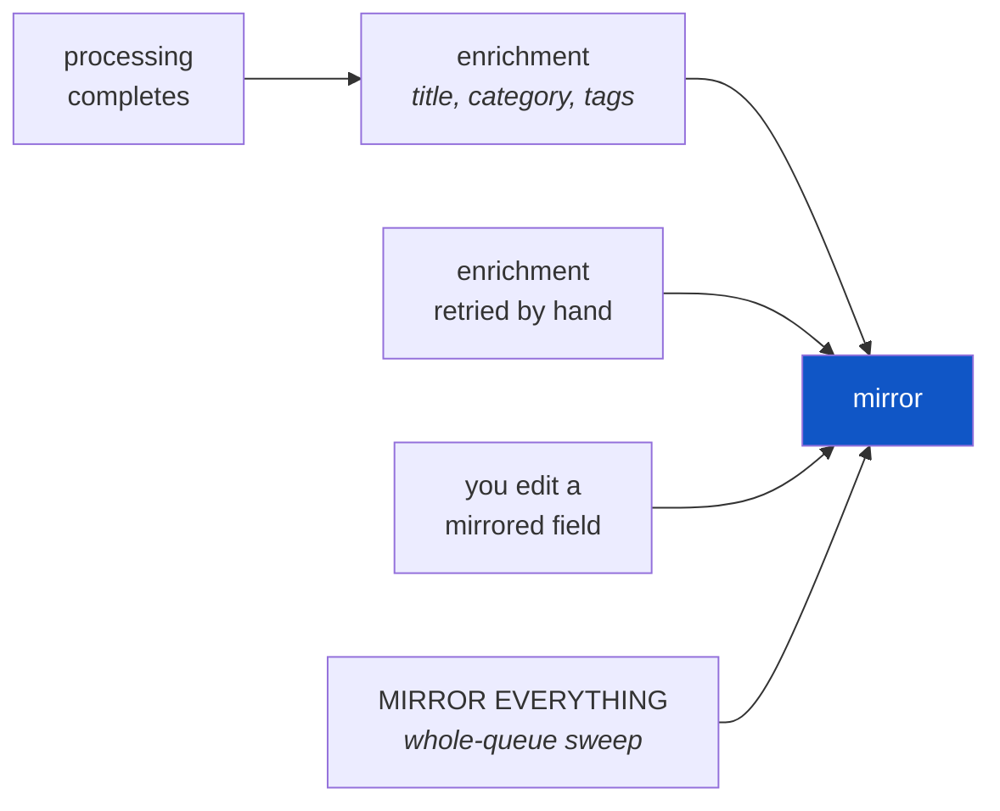

# User guide

Everything the [README](../README.md) leaves out: what each capture type does,
the tabs, providers and their wire contracts, the hand-off, the note vault,
shortcuts, the focus timer and what lands on disk. Build, signing and release
steps live in [`platform-setup.md`](platform-setup.md); the engineering rules
behind all of it are in [`CLAUDE.md`](../CLAUDE.md) and
[`docs/architecture/`](architecture/).

## 📥 What it captures

| | Type | Stored as | Processing | Where it works |
| --- | --- | --- | --- | --- |
| 🎙 | microphone recording | `.m4a` | transcription | everywhere |
| 📝 | text note | `.txt` | passthrough, no network | everywhere |
| 🎧 | audio upload | original ext | transcription | everywhere |
| 🖼 | image | `.jpg` / `.png` | **OCR** — a vision model | everywhere |
| 🎬 | video | `.mp4` / `.mov` | audio track → transcription | Android/iOS natively; desktop via `ffmpeg` |

Image OCR is **LLM-only**. It sends the image to whichever vision model your
enrichment profile points at — **OpenAI, Anthropic or Google Gemini**, all three
one click away in Models — and it behaves identically on a laptop and on a
phone. There is no local OCR engine to install, no language packs, and no
platform where images quietly work better than on another.

That is deliberate, not a gap: one configured endpoint answers for both OCR and
enrichment, with the same behavior on every platform.

```bash
# the one optional desktop binary — video and long-audio splitting
sudo apt-get install ffmpeg     # Debian/Ubuntu
brew install ffmpeg             # macOS
winget install Gyan.FFmpeg      # Windows
```

Neither a missing binary nor a missing profile is a crash: the item is still
ingested, verified and listed, its processing lands `failed` with a readable
error and a retry button, and the source file is untouched. Add the profile
later and press retry.

---

## 🖥 The eight tabs

| Tab | What it is for |
| --- | --- |
| **Queue** | every capture, review progress, search, filters, playback, inline editing, manual daily connection review |
| **Timer** | a focus session — countdown dial, session goal, alarm at zero — plus what got finished lately |
| **Projects** | repository contexts, active project, per-project captures, one-click coding-agent sessions |
| **Work** | read-only Todoist focus list, due counts, and manually linked Capture project context |
| **Clipboard** | clipboard history, searchable, with a preview pane and in-place editing |
| **Models** | provider profiles — transcription and enrichment, add / edit / activate |
| **Logs** | live pipeline events (persist, queue, transcribe, errors) with a level filter |
| **Config** | appearance, audio parameters, global shortcuts, enrichment profile, note vault, keyring status |

**Work dashboard:** Open Work and paste a personal API token from Todoist
Settings → Integrations → Developer. Capture stores it in the OS keyring, reads
projects and tasks from Todoist API v1, and never changes Todoist tasks. The
focus list shows up to five `@founder` P1/P2 tasks and urgent due tasks; the
due counts include all tasks due today or overdue. Choose a Todoist project and
map it to a Capture project to see recent captures and completed focus sessions.
The mapping is local to this device. Refresh is manual, and task rows open in
Todoist.

**Daily connections:** In Queue, choose **REVIEW CONNECTIONS**, pick a date,
then run **REVIEW DAY**. The active enrichment model reviews every capture from
that local calendar day with processed text, using its title, summary and text
excerpts. It suggests overlapping topics, complementary ideas, different
perspectives and app improvements, with links back to the original captures.
The report stays in the open dialog; closing it discards the suggestions. The
review never edits or merges captures. Model-provider charges may apply; review
calls appear in overall model costs rather than on a capture card. Missing usage
or pricing remains unpriced.

### A queue row, annotated

```
┌────────────────────────────────────────────────────────────────┐
│ [#]  Sprint planning notes                    play  edit  done │  (1)
│      meetingNote    backend-api                                │  (2)
│      We agreed to postpone the migration until the index       │  (3)
│      durability work lands, and to split the router...         │
│      file verified · 6.8 MB · persisted                        │  (4)
└────────────────────────────────────────────────────────────────┘

 (1)  Type icon — replaced by the extracted video poster in the identical
      geometry, so a row's shape never depends on whether a frame was pulled.
      The title comes from enrichment; with no profile it reads "Recording ·
      14:32" — never the filename, because a column of uuids is unscannable.
 (2)  Category and project. Both are *labels*, so both render outlined;
      only the pipeline status ever gets a filled pill.
 (3)  The processor's output — transcript, OCR result, or the note body.
      This is what Queue search matches on.
 (4)  Measured by the very check that proved the file was non-empty at capture
      time. It is never an estimate; captures saved before it was recorded
      simply omit the segment rather than printing "0 B".
```

The action strip is **play / edit / done** — all cheap and reversible. `DELETE`
lives one level deeper, inside the editor, behind a dialog that names the item:
queue rows all look alike, and a destructive control a few pixels from `play` is
the one mis-tap this app cannot undo.

### Filters

Five status chips that **partition** the list, each with a live count:

| Chip | Holds |
| --- | --- |
| `ALL` | everything — the union of the four below |
| `QUEUE` | queued, plus the one currently running |
| `READY` | processing finished |
| `FAILED` | processing failed; source intact, retry offered |
| `RAW` | persisted and verified, not yet handed to a processor |

…intersected with a second, independent axis: `DESK` / `OFF DESK` / `ANY`. That
one is about *you*, not the pipeline — nothing in processing ever sets or clears
it. Counts describe the queue, not the search box.

### Keyboard

The Queue is fully drivable without the mouse. Letters carry no modifier — a
focused text field eats them first, so `e` types an "e" in search and edits a row
everywhere else.

| Key | Action | | Key | Action |
| --- | --- | --- | --- | --- |
| `↑` `↓` / `J` `K` | move selection | | `R` | route / hand off |
| `E` | edit inline | | `Space` | play |
| `D` | mark done | | `Ctrl/⌘+F`, `/` | search |
| `Esc` | clear selection | | | |

### Three layouts, one shell

```
   under 600 px          600 - 900 px            900 px and up
 ┌────────────┐      ┌────────────────┐      ┌──────┬────────────────┐
 │   rows     │      │     cards      │      │ rail │     cards      │
 │ [========] │      │ [============] │      │ logo │ [============] │
 │ [========] │      │ [============] │      │ nav  │ [============] │
 │            │      │        (o)dock │      │ (o)  │                │
 ├────────────┤      ├────────────────┤      └──────┴────────────────┘
 │ nav  (o)   │      │      nav       │
 └────────────┘      └────────────────┘
  nav bar carries     nav bar plus a       a 216 px column carries
  the capture         floating capture     navigation AND capture,
  buttons inline      dock                 so neither bar is drawn
```

Chosen from a `LayoutBuilder`, not `MediaQuery`, so dragging a desktop window
narrow really does fall back through all three.

---

## 🔌 Connect a provider

No code change and no rebuild: open **Models → + profile**, pick a preset, paste
a key. Presets ship for:

| Transcription | Enrichment / vision |
| --- | --- |
| OpenAI transcribe · OpenAI Whisper | **OpenAI** · **Anthropic** · **Google Gemini** |
| Groq | Groq chat *(no vision model — images will fail)* |
| Local whisper.cpp (`localhost:8080`) | Local Ollama (`localhost:11434`) |
| Custom endpoint | Custom endpoint |

Exactly one profile is active per kind, and the two are independent. **No profile
= that stage is simply disabled** — recording and persistence carry on unchanged.

**The three bolded presets are the defaults worth picking**, because an
enrichment profile does double duty: it writes titles, categories, summaries and
tags *and* it is the OCR engine for image captures. All three ship with a
vision-capable model pre-filled, so one key turns on both stages at once.

| Preset | Endpoint | Ships with | Key looks like |
| --- | --- | --- | --- |
| **OpenAI** | `api.openai.com/v1/chat/completions` | `gpt-5.6-luna` | `sk-…` |
| **Anthropic** | `api.anthropic.com/v1/chat/completions` | `claude-haiku-4-5` | `sk-ant-…` |
| **Google Gemini** | `generativelanguage.googleapis.com/v1beta/openai/…` | `gemini-3.6-flash` | `AIza…` |

Each defaults to the **cheap, fast** member of its family rather than the
flagship — this stage runs on every single capture and reads at most 12 000
characters — with the larger models one chip away in the editor. Anthropic and
Gemini are reached through their **OpenAI-compatible** endpoints, so all three
speak one request shape and the app needs no per-vendor adapter.

> Both of those compatibility layers do **not** honour `response_format:
> json_object` the way OpenAI does, so for them the JSON contract rests on the
> prompt alone. The parser is built for that: it strips a stray ` ```json `
> fence and degrades field by field rather than throwing, which is why they work
> anyway. Worth knowing if you point a profile at a fourth vendor.

<details>
<summary><b>Seeding the first profile from the command line</b></summary>

Read **only on the first run**, when there is no `settings.json` yet. Afterwards
the stored profiles win and these are ignored.

```bash
flutter run \
  --dart-define=TRANSCRIPTION_ENDPOINT=https://api.openai.com/v1/audio/transcriptions \
  --dart-define=TRANSCRIPTION_TOKEN=sk-… \
  --dart-define=TRANSCRIPTION_MODEL=whisper-1 \
  --dart-define=TRANSCRIPTION_LANGUAGE=en
```

</details>

### The transcription contract

Any endpoint that speaks this shape works — that is the whole integration:

```bash
curl -X POST https://your-endpoint.example/v1/audio/transcriptions \
  -H "Authorization: Bearer $TOKEN" \
  -F file=@recording.m4a \
  -F model=whisper-1
```

```jsonc
{ "text": "Transcript body" }     // "transcript" is accepted as a fallback key
```

### The enrichment contract

An OpenAI-compatible `/v1/chat/completions` with `response_format: json_object`,
which is why OpenAI, Groq and a local Ollama all work unmodified. The model
answers:

```json
{
  "title": "Sprint planning — migration postponed",
  "category": "meetingNote",
  "summary": "Migration deferred until index durability lands; router split agreed.",
  "tags": ["backend", "migration", "sprint"]
}
```

`category` is a closed list of **routing destinations, not topics** — which is
what keeps the vocabulary small enough for a small model to classify reliably:

```
note · task · agentTask · idea · meetingNote · researchLead · capture
```

Parsing degrades rather than throws: an unknown category becomes `capture`, a
blank title becomes null, tags are lowercased, de-duplicated and capped at five.
Enrichment writes `title` only when blank and `category` only when null, and
fills `tags` only when the list is empty — so a retry can never overwrite what
you set by hand.

### 🔐 Tokens at rest

Encrypted with **AES-256-GCM** under a master key held in the OS keyring
(Keychain / libsecret / DPAPI), stored as `enc:v1:<base64>`. Legacy plaintext
tokens migrate on the first load with a working keyring. **No keyring → clean
plaintext fallback, said out loud** in the Models and Config tabs rather than
failed silently.

---

## 📤 Hand-off

Pressing `R` on a capture appends it to `inbox.md` in that capture's project
repository, then marks it `OFF DESK`. Delivery happens first, state second: a
throw leaves the item open and retryable.

```markdown
## Sprint planning — migration postponed

*2026-08-05T14:32:11.482 · meetingNote · #backend · #migration*

> Migration deferred until index durability lands; router split agreed.

We agreed to postpone the migration until the index durability work lands…
```

A plain file was chosen over any tracker API deliberately: it needs no token and
no network, so it does not trade away the one property the app is built on, and
the result is readable by every tool you already have.

Each project card carries a `CAPTURES (n)` button that opens everything filed
under it in a sheet — searchable, and editable in place with the same inline
editor the Queue uses, so reviewing one project's thinking does not mean
filtering the whole queue down to it and then losing that filter.

---

## 🗄 Note vault — Obsidian and friends

Point the app at a directory you own — an Obsidian vault, a synced folder, a
plain notes repository — and **every capture is mirrored there as a markdown
file**, with the enriched title, category and tags in YAML front matter.

```
Config -> NOTE VAULT                                   [ MIRRORING ]
  ┌──────────────────────────────────────────────────────────────┐
  │ VAULT DIRECTORY   /Users/you/Obsidian/Second Brain    [ .. ] │
  │ SUBFOLDER         Capture                                    │
  │ SOURCE FILES      ( COPY INTO VAULT )  ( NOTE TEXT ONLY )    │
  │                                                              │
  │ NOTES        /Users/you/Obsidian/Second Brain/Capture        │
  │ ATTACHMENTS  …/Capture/attachments                           │
  │                                                              │
  │                                     [ MIRROR EVERYTHING ]    │
  └──────────────────────────────────────────────────────────────┘
```

An empty directory field is the off switch — deliberately, rather than a
separate "enabled" checkbox, because two fields would allow the state *enabled,
nowhere to write*, which can only ever be reported as an error nobody asked for.
The status pill reads `MIRRORING` or `OFF`, and the two resolved paths are shown
because a subfolder typo and a working vault are otherwise the same screen.

**`MIRROR EVERYTHING` is the backfill, and it is not a convenience.** Mirroring
only *new* captures would leave the queue you already have permanently outside
the vault, with no way in short of re-recording it. The sweep runs sequentially
on purpose — a hundred concurrent writes into a directory your notes application
is watching buys nothing but a stampede of file events — and skips captures with
no text yet. On desktop the directory field carries a browse button behind the
same `DirectoryPicker` seam the project editor uses; the typed field stays
authoritative everywhere.

### Connections and next step

After a new capture is mirrored, Capture searches Markdown notes in the vault
for shared terms and selects up to five candidates. The configured enrichment
model receives the capture text, the candidate titles and short excerpts, plus
the existing profile/project context. It suggests whether to act now, keep the
idea for later, or clarify it. An existing P0–P3 priority takes precedence
over a contradictory suggestion. With no model configured, the decision stays
`clarify`; keyword overlap alone is not a priority judgment.

The result is a separate `Capture/Analysis/<capture-id>.md` note with Obsidian
links and the shared terms behind each match. The capture detail view shows the
assessment and has **READ ANALYSIS** and **REFRESH CONNECTIONS** controls. A
failed analysis can be retried without affecting the capture or its vault note.
Capture does not overwrite an analysis note you edited in Obsidian. The model
only suggests a next step; it does not create a task or run an agent command.
`MIRROR EVERYTHING` copies old captures without automatically requesting model
analysis for the whole library.

### What lands in the vault

```
Second Brain/                 ← your vault, your filing system
└── Capture/                  ← notes land in a subfolder, never the root
    ├── 2026-08-05-1432-sprint-planning-migration-postponed-3f2a1c4e.md
    ├── 2026-08-05-0917-notatka-o-wdrozeniu-9d1077ef.md
    └── attachments/          ← Obsidian's own convention
        ├── 3f2a1c4e-….m4a
        └── 9d1077ef-….jpg
```

```
 2026-08-05-1432  -  sprint-planning-migration-postponed  -  3f2a1c4e  .md
 └─ when ────────┘   └─ slug of the title ──────────────┘   └─ id ──┘
    sortable            decoration — may be stale              the only
                        after a re-title                       part that
                                                               identifies
```

```markdown
---
title: "Sprint planning — migration postponed"
created: 2026-08-05T14:32:11.482Z
date: 2026-08-05
type: note
capture-type: audioRecording
category: meetingNote
project: "augustyniak-capture"
tags: ["backend", "migration"]
duration: 3m 04s
source: "3f2a1c4e-….m4a"
related: ["[[MOC-Augustyniak-Capture]]"]
capture-id: 3f2a1c4e-…-c81b
capture-hash: 8f14e45fceea167a5a36dedd4bea2543…
---

# Sprint planning — migration postponed

> Migration deferred until index durability lands; router split agreed.

![[attachments/3f2a1c4e-….m4a]]

We agreed to postpone the migration until the index durability work lands…
```

The two machine fields sit **last** on purpose, so the plumbing lands at the
bottom of the property list your reader shows rather than above your own
metadata.

### When it writes

Three trigger points, and the list is deliberately short:



**Mirroring runs *after* enrichment, never before — and that ordering is the
load-bearing part.** A note written first would be filed as
`2026-08-05-1432-recording-1432-3f2a1c4e.md` and would have to live with that
name for good, because rule 2 above forbids ever renaming it. Waiting the extra
moment is what buys a file name that says what the capture was. It runs whether
or not enrichment *succeeded*: an install with no profile still wants its
captures copied.

A hand edit reaches the vault only when it changed something a note actually
prints — `title`, `category`, `summary`, `transcript`, `projectId` or `tags`.
Status transitions and poster paths appear nowhere in a note, so mirroring on
them would rewrite every file in the vault on every pipeline tick. Equally, the
processing and enrichment paths mirror explicitly at their own tails rather than
from the shared `_update` funnel — doing both would write the same note two or
three times per capture, and each of those writes lands as a file event in
whatever is watching the directory.

### Mirror, not route — and that distinction is the whole design

| | Hand-off (`CaptureRouter`) | Vault (`NoteVault`) |
| --- | --- | --- |
| **Delivers** | once | the same note, over and over |
| **Write mode** | append-only | rewrite in place |
| **Closes the item** | yes, sets `OFF DESK` | no, it is a copy |
| **Twice** | two entries — both really happened | one file, updated |

A route is a delivery. A vault holds *the same thought over time*: enrichment
names it minutes after it was created, and you may correct a transcript a week
later. Folding the two together would give you either an inbox accumulating
duplicates of one thought, or a mirror that could never record a second delivery
honestly.

### Four rules, because the vault is not ours

The reader does not merely edit these files — their application indexes them,
links them, and reorders lists by modification time. So:

1. **A note is located by id, never by name.** The file name carries the first
   eight characters of the capture id as a suffix; the rest is decoration. That
   is what lets a title arrive from enrichment *after* the file already exists.
2. **The name is then never changed again.** Renaming a file behind your back
   would break every `[[wikilink]]` you had written to it, and nothing in this
   app could repair them. A later title lands in the front matter and the
   heading — the same information, without the cost.
3. **A file is only rewritten while it is still ours.** `capture-hash` is the
   sha-256 of the body beneath the front matter. A mismatch means you edited the
   note, and the mirror steps back. The claim lives *in the file* rather than in
   `recordings.json`, so a vault rebuilt after a reinstall still knows which
   notes it owns.
4. **An unchanged note is not rewritten at all.** A no-op write would still bump
   the mtime and shove the note to the top of your "recently modified" list on
   every unrelated pipeline tick.
5. **Front matter the app did not write is kept.** `type` is always `note`, so
   the file fits a vault whose `type` is a closed list of note kinds; what was
   captured sits in `capture-type`. `related` is seeded with one map-of-content
   link so the note is never an orphan, and once you extend that list it is
   yours. `tags` is always present: a capture that enrichment left untagged
   carries `tags: ["capture"]`, because your linter wants the key on every
   note and a tag you add by hand in the vault would be gone on the next
   rewrite. Anything your indexer appends below `capture-hash` — `pagerank`,
   `cluster`, `aliases` — comes back verbatim on the next update.

Every mirror reports which of these applied, and a sweep over the queue counts
them for the Config tab:

| Outcome | Meaning |
| --- | --- |
| `created` | no file for this capture existed |
| `updated` | still ours, and a mirrored field changed |
| `unchanged` | already identical — no write, on purpose |
| `foreign` | **you edited it.** Left alone, and counted rather than swallowed: this is the one outcome that looks like a failure and is in fact the mirror doing its job |

Mirroring is best-effort under the same contract as the clipboard: it runs after
the capture is already persisted, swallows its errors into the Logs tab, and
**never touches `status`**. A vault on an unmounted drive costs you a copy, never
a capture. Writes are atomic (`.tmp` → `rename`) for a sharper reason than
usual — a torn write would leave a file whose hash no longer matches its body,
which this code would then read back as *your* edit and refuse to touch ever
again.

> **Polish diacritics are transliterated in file names, not dropped.** These
> captures are largely Polish, and `notatka-o-wdroeniu` names nothing. Slugs are
> ASCII, lowercase, hyphenated, capped at 48 characters and cut on a word
> boundary so a shortened name still reads as a title.

> **`Copy sources` is a switch rather than a constant** because the two answers
> differ by gigabytes on a vault that syncs. On, an audio capture is playable
> straight from your reader. Off, the vault stays text-only and the media stays
> where it already lives. Text notes never attach their `.txt` either way — the
> body is already printed above it.

---

## ⌨️ Global shortcuts (desktop)

System-wide, firing while the window is minimised or unfocused. Editable in
Config, stored in `settings.json`.

| Shortcut | Action | |
| --- | --- | --- |
| `Ctrl+Alt+A` | show the window | ✅ ships bound |
| `Ctrl+Alt+R` | start / stop recording | ✅ ships bound |
| `Ctrl+Alt+N` | new text note | ✅ ships bound |
| — | upload audio / image / video | ⚪ bindable, ships unbound |
| — | start / pause the focus timer | ⚪ bindable, ships unbound |

Recording and the focus timer are the two actions that do **not** raise the
window first — the point of those hotkeys is not leaving whatever you were in.
Both raise it *after* a successful start (recording so the microphone is never
kept waiting, the timer so a started session is visible on the tab that owns it)
and leave the window alone when you stop or pause: that decision is already
taken, and pulling the app forward would interrupt what you went back to.

The timer shortcut ships unbound because `Ctrl+Alt+T` is GNOME's own *open a
terminal*, and a global binding that quietly won over it would break something
outside this app.

> **Linux caveat:** `Shift` + a letter, digit or symbol binds successfully and
> then never fires — `keybinder` grabs the *unshifted* keyval, so X resolves the
> press to a different keysym. `Shift`+`F1`–`F12`, space or Enter are safe, and
> the app refuses the broken combinations up front rather than registering them
> into silence. `Super` is unusable under GNOME regardless.

---

## ⏱ Focus timer

A Pomodoro countdown on its own tab, next to the Queue. **40 minutes by
default** — the classic 25 is short for the kind of work this app sits beside,
and the length is a row of chips (15 / 25 / 40 / 50 / 60 / 90) plus `+5 MIN`
for stretching a session already under way.

- The dial counts **down**: the ring drains clockwise from twelve, the clock
  face dims behind it, and a sweep circles the ring for as long as the session
  is actually running — so a glance from across the desk separates *running*
  from *paused* without reading digits.
- **A session goal** sits under the dial. It is carried into the log line the
  session writes when it ends, and it survives `RESET`, because the next
  pomodoro is usually the same piece of work.
- **An alarm at zero**, chosen from `Chime` / `Bell` / `Ping` / `Silent`, with a
  preview button so picking one does not mean waiting out a session. The clips
  ship inside the app like the fonts do — nothing is fetched, so the alarm
  rings offline. A device that refuses to play it costs the sound, never the
  session.
- The countdown reads the **clock**, not a counter. Close the laptop mid-session
  and open it an hour later: the timer has finished, rather than claiming the
  time you slept through is still yours.
- The length and the alarm are saved in `settings.json`; the running session is
  never written to disk — there is nothing in a countdown worth resuming.

### What got finished lately

Above the session history sits `MOMENTUM`, which answers a different question:
not how long you worked, but how much came *out* of it.

```
4  closed today                                          target 3 ✓
pace 3.2/day  ↑

[7 DAYS]  [30 DAYS]                                       23 in 7 days

Mon  ████████████────────────────────────────────────   5
Tue  ██████████──────────────────────────────────────   4
Wed  ██──────────────────────────────────────────────   1
Thu  ────────────────────────────────────────────────   –
Fri  ████████████████████████────────────────────────   6
```

- **It counts *closing*, never capturing** — and that is the whole design. A
  metric that rewards capture volume is satisfied by a three-second recording at
  23:58, and the junk it produces lands in the queue you then have to drain. A
  closure cannot be moved without first capturing something real and then
  dealing with it, so doing the work is the cheapest way to move the number.
- **The daily target comes from your own pace** — the median across *active*
  days in the last fortnight, floored at 1. Active days, not calendar days: a
  weekend must not drag it to zero, because a target of zero cannot be missed
  and therefore says nothing. A median rather than a mean, so one exceptional
  afternoon does not raise the bar for the two weeks after it.
- **The floor of 1 is the feature, not a guard.** A fresh install and a return
  after a fortnight away both meet a target of 1 — a guaranteed win on the first
  day back, instead of the target that was current when you fell off.
- A capture counts **once, ever**. Un-ticking a row and re-ticking it adds
  nothing, so the tally measures work rather than clicking.
- It lives in `closures.jsonl`, appended and never rewritten — deliberately not
  derived from `recordings.json`, which is rewritten whole and shrinks when you
  delete a capture. History read from there would be silently rewritten by a
  deletion.

### What actually got done

`SESSIONS DONE` counts pomodoros **that reached zero**. Pausing, resetting
or abandoning one leaves it out entirely, which is the only reason the number is
worth looking at — a count you can inflate by starting things is not a record of
work.

```
3 sessions today                                        95 min focused

Thu  ────────────────────────────────────────────────   –
Fri  ────────────────────────────────────────────────   –
Sat  ██████████──────────────────────────────────────   1
Sun  ────────────────────────────────────────────────   –
Mon  ██████████──────────────────────────────────────   1
Tue  ██████████──────────────────────────────────────   1
Wed  ██████████████████████████████──────────────────   3

WHERE IT WENT
Augustyniak Capture                              3 · 130 min
Reading                                           1 ·  40 min
Note vault                                        1 ·  25 min
No project                                        1 ·  15 min
```

- The empty days are drawn on purpose: *three a day* and *three once a week* are
  the same list of numbers and a very different working week.
- A session is filed under the project that was active **when it ended**, and
  both the id and the name are stored — so renaming a project keeps one row, and
  deleting one does not erase the hours you spent on it.
- Time with no project active keeps its own row at the bottom rather than being
  hidden, because otherwise the rows stop adding up to the week above them.
- It lives in `focus-sessions.jsonl`, appended one line at a time and never
  rewritten. Nothing can reconstruct last Tuesday's four sessions, so the file
  is never written whole.

---

## 💾 Files on disk

Everything lives in the `recordings/` subdirectory of the app documents
directory. Every rewrite is atomic (`.tmp` → `rename`).

```
recordings/
├── 3f2a…-c81b.m4a          ← source material, one file per capture
├── 3f2a…-c81b.thumb.jpg    ← derived video poster (safe to delete)
├── 9d10…-77ef.txt
├── recordings.json         ← the index — every capture, rewritten whole
├── settings.json           ← profiles, audio params, shortcuts, theme, vault, timer
├── projects.json           ← projects + the active one
├── logs.json               ← ring buffer, max 500 events
├── gamification.json       ← lifetime totals + unlocked milestones
├── revisions.jsonl         ← append-only history of overwritten values
├── focus-sessions.jsonl    ← append-only log of pomodoros that reached zero
└── closures.jsonl          ← append-only log of captures that left the desk
```

The three `.jsonl` files are appended one line at a time and **never rewritten**,
unlike every `.json` above them. Each holds the only copy of something nothing
can reconstruct — what a value used to be, that last Tuesday had four sessions,
that you finished six things on Friday — so none of them may be written whole.

Three things deliberately live **outside** that directory, because they belong to
you rather than to the app: your project repositories (and the `inbox.md` in
each), your [note vault](#-note-vault--obsidian-and-friends), and the master key
for token encryption, which is in the OS keyring.

<details>
<summary><b>What a row in <code>recordings.json</code> looks like</b></summary>

```json
{
  "id": "3f2a1c4e-…-c81b",
  "type": "audioRecording",
  "createdAt": "2026-08-05T14:32:11.482Z",
  "status": "completed",
  "durationMs": 184000,
  "sizeBytes": 7127040,
  "title": "Sprint planning — migration postponed",
  "category": "meetingNote",
  "summary": "Migration deferred until index durability lands.",
  "tags": ["backend", "migration"],
  "transcript": "We agreed to postpone the migration…",
  "projectId": "b71f…",
  "isProcessedByUser": true,
  "processedAt": "2026-08-05T15:04:02.110Z",
  "routes": [
    { "at": "2026-08-05T15:04:02.100Z", "kind": "file", "target": "inbox.md · capture" }
  ]
}
```

Every `fromJson` is backward compatible: a field absent from an older row gets a
default rather than dropping the row.

</details>

<details>
<summary><b>Why <code>revisions.jsonl</code> is the one append-only store</b></summary>

Enrichment and the inline editor both *replace* text — a title, a summary, a
whole transcript on a re-run. `revisions.jsonl` holds what was overwritten, so it
is the only copy of that text left anywhere.

A file whose job is preserving lost values must not itself be overwritable, so it
appends (`FileMode.writeOnlyAppend`) instead of rewriting like every other store
here. A kill can cost the row being written and nothing else; a torn final line
is skipped on load. Only five fields are tracked (`title`, `category`, `summary`,
`tags`, `transcript`), and a change *out of an empty value* is never recorded —
filling a blank overwrites nothing, which is what keeps the file small.

The history surfaces as a collapsed `HISTORY` section at the bottom of the inline
editor, with a copy button per entry that hands back the **previous** value in
full.

</details>

> ⚠️ **On iOS and Android none of this survives a reinstall.** There, the app
> documents directory lives *inside* the app container, and a new signature, a
> changed `applicationId` or `flutter run` after an uninstall takes the container
> — with the `.m4a` files in it — with it. No code in this repo can stop that,
> so take a copy first: **Config → ARCHIVE** exports a zip, and importing it
> merges it back additively, never overwriting a source
> ([`architecture/backup.md`](architecture/backup.md)).

---

## Long audio has three ceilings

A single transcription request is bounded by the 25 MB upload cap (a 400), by the
`gpt-4o` family's 1500 s duration limit (also a 400) — and by that family's
**2000-token output limit, which answers HTTP 200 with a truncated transcript**.
The third is the dangerous one: a twenty-minute capture came back as nine minutes
of text, was written `completed`, went to the clipboard, and had its title
enriched from the part that survived.

| Platform | Answer |
| --- | --- |
| **Desktop** | `ChunkedTranscriptionService` splits with `ffmpeg` into 5-minute parts, transcribes sequentially, joins. A file that yields one part is passed through unwrapped. |
| **Mobile** | No `ffmpeg`, so the recording itself is capped — `~8 min` on the `gpt-4o` family, `25 MB ÷ bitrate` otherwise (52 min at 64 kbps). The countdown and its reason are on the capture screen, and reaching it calls the same `stopRecording` the SAVE button calls. **The capture is saved, never discarded.** |

---

## 🎨 The interface

A "Processing Console" direction, in **two themes** (system / dark / light,
picked in Config → Appearance):

- 🎨 the augustyniak.ai design system's semantic tokens resolved to hex, accented
  in house **blue** (`#59A0F8` dark, `#1056C6` light);
- 🔤 **Space Grotesk** for names and headings, **JetBrains Mono** for everything
  factual — statuses, counters, timers, file facts. Both are vendored under
  `assets/fonts` (SIL OFL) rather than fetched at runtime, because an
  offline-first app must not need the network to render its own text;
- 📜 no app bar — each tab draws its own header inside its scroll area, so the
  title scrolls with the content;
- 🔇 no snackbars. Feedback is inline, and dialogs are reserved for confirming
  something destructive;
- ✅ one filled pill per row: the pipeline status, because it is the only *state*
  there. Project and category are labels and render outlined. The resting state
  draws no badge at all — `READY` on twenty-seven rows out of twenty-eight makes
  the one failing row compete with a wall of green saying everything is fine.
